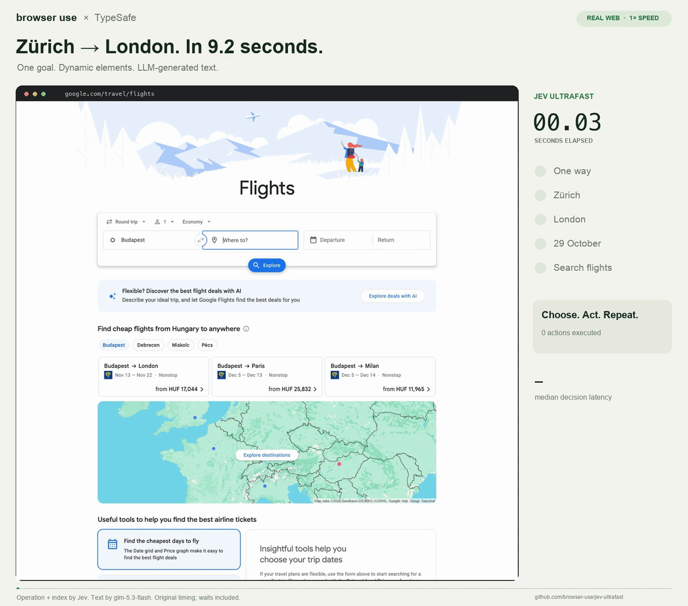
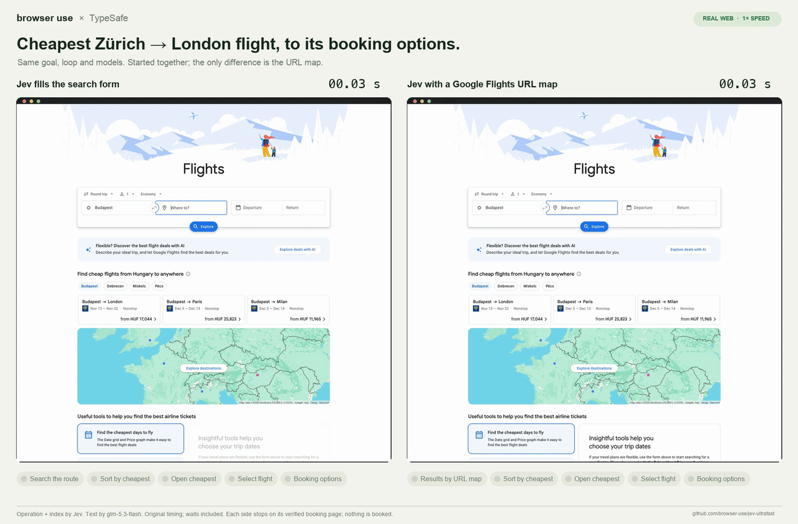

# Jev Ultrafast ⚡

> [!IMPORTANT]
> **The Browser Use Cloud waitlist is open.** Get early access to ultrafast browser agents in the cloud.
> **[Join the waitlist →](https://browser-use.com/ultrafast?utm_source=github&utm_medium=readme&utm_campaign=jev-ultrafast)**

**A browser agent with a dynamic, indexed action space.**

Give it one goal. [TypeSafe's Jev](https://docs.typesafe.ai/introduction) picks an operation and an element. A small LLM writes text only when the operation is `TYPE_TEXT`.

**Zürich → London on Google Flights in 9.2 seconds.** One natural-language goal, actual text generation, and loading waits included.

<a href="docs/demo.mp4"></a>

[Watch the MP4](docs/demo.mp4) · [Measurements](docs/performance.md) · [Read the loop](jev_ultrafast/agent.py)

## The action space

Every observation produces a new element table:

```text
[1] button    Change ticket type · Round trip
[2] combobox  Where from?        · San Francisco
[3] combobox  Where to?          · empty
[4] textbox   Departure          · empty
...
```

The operations are `CLICK`, `TYPE_TEXT`, `SELECT`, `SCROLL_UP`, `SCROLL_DOWN`, `WAIT`, `DONE`, and `BLOCKED`, plus named nested-region scroll operations when a visible scroll container is sampled. Only supported operations and targets are offered.

```text
                      one TypeSafe request
                     ┌───────────────────────────┐
page → element table → operation                 │
                     │ click_target              │
                     │ type_text_target          │
                     │ select_target, if present │
                     └─────────────┬─────────────┘
                         use the matching target
                                   │
                    CLICK [7] ─────┤──→ browser
                TYPE_TEXT [3] ─────┘
                          ↓
                   small LLM → text → browser
```

Target questions are speculative. If the operation is `CLICK`, only `click_target` can execute. Two decisions, **one network round trip**. Each target head contains only compatible elements. Native dropdown choices carry an observed element/option index.

There are no site-specific action scripts or prepared field strings in the policy. The Flights example supplies a goal and independently verifies the outcome. The screenshot renderer adds labels afterward; it does not drive the browser.

## Try it

```bash
git clone https://github.com/browser-use/jev-ultrafast.git
cd jev-ultrafast
uv sync
cp .env.example .env
# Add TYPESAFE_API_KEY and TEXT_MODEL_API_KEY.
uv run jev
```

Open **http://127.0.0.1:8766** and click **Start demo → Run automatically**. The inspector shows numbered elements, operation probabilities, target probabilities, and executed actions. **Choose next** pauses before execution.

Set `TYPESAFE_DEMO_PORT` in `.env` to run the inspector on a different local port.

The browser emulates a 1470×1470 page: a 13-inch MacBook Air's width, so sites keep their desktop layout, and tall enough that dialog buttons such as Google's consent choices are on screen without scrolling. Set `JEV_VIEWPORT=WIDTHxHEIGHT` to change it. In a comparison of 1120×780, 1470×830, 1470×1470 and 1470×1660, the Google Flights benchmark took the same actions at every size with the same decision latency and confidence; the taller sizes only skipped the scroll to Google's consent buttons.

Chrome connects through [Browser Harness](https://github.com/browser-use/browser-harness), installed by `uv sync`. Run `uv run browser-harness --doctor` if it needs connecting. Allow remote debugging in Chrome when prompted.

`TEXT_MODEL_API_KEY` is an OpenRouter key in the example configuration. The current video uses `glm-5.3-flash` through OpenCode Go with reasoning effort `none`; earlier recordings used `inception/mercury-2.5` through OpenRouter. Gemini, GLM, and DeepSeek can also use the OpenAI-compatible text helper; configure the appropriate model, endpoint, and reasoning setting. For OpenCode Go, set `TEXT_MODEL_BASE_URL=https://opencode.ai/zen/go/v1` and a model such as `glm-5.3-flash`; each run sends one stable `x-opencode-session`, and `TEXT_MODEL_REASONING` becomes `reasoning_effort` (default `low`).

## Use the library

```python
from jev_ultrafast import Agent

with Agent(
    "https://www.google.com/travel/flights?hl=en",
    "Find one-way flights from Zurich to London on October 29, 2026, "
    "for one adult in economy. Stop when matching flight options are visible.",
) as agent:
    for state in agent.run():
        print(state["elapsed_ms"], state["status"])
```

Returned states are detached snapshots with cumulative history and decisions. Process them as they arrive, or retain only the fields you need: keeping every full snapshot uses storage that grows quadratically with the number of steps.

Run with `uv run --env-file .env python your_script.py`. The same policy can run a different task:

```bash
uv run --env-file .env python examples/run.py \
  --url https://en.wikipedia.org/wiki/Main_Page \
  --goal 'Find and open the Wikipedia article about Gödel’s incompleteness theorems.'
```

`uv run --env-file .env python examples/flights.py --keep-open` performs the flight search, checks the actual route/date/results, and saves its trace. It does not select or book a flight.

## Why it moves

- **One request per decision cycle.** Operation and target heads share the same observed state.
- **No screenshots in the default agent loop.** Jev consumes structured state. The inspector opts into screenshots; the video uses a separate continuous screencast.
- **One browser call per snapshot.** Read visible controls, their names, values, and text atomically. Keep references to the actual DOM nodes.
- **Validate the selected target.** Clicks check the document, form values, target, and nearby context. Animation alone does not force another prediction. Resolve current geometry and reject covered controls before input.
- **Wait for useful state.** After typing into a combobox, wait for visible suggestions, capped at 200 ms. After clicking a same-tab HTTP(S) link to a different URL, wait for the URL or document to change, capped at 1,500 ms. Downloads and links targeting other tabs keep the fast path. Other interactions get at most two animation frames or 50 ms. These reads happen after execution is logged.
- **Keep hidden tabs rendering.** Focus emulation prevents background animation throttling without switching Chrome's visible tab.
- **Send visible text.** Offscreen article bodies and footers do not fill the model context.
- **Target visible nested scrolling.** Sampled scrollable feeds and sidebars become named, freshness-checked actions.
- **Reuse an interrupted text request.** A generated value survives a stale-page retry only if the entire text-helper input is unchanged and it is for the same field.

Every executed target is resolved from an observed node. The executor rechecks page freshness and click occlusion. Model output never becomes selectors, coordinates, shell commands, or executable JavaScript. Text-helper output must parse as a small JSON object before typing.

Native dropdowns retain the identity of each observed option, so duplicate values cannot redirect a selection. Changes to option identities, order, values, labels, selection, disabled state, or the dropdown's multiple-selection mode invalidate its selection guard.

## Small enough to read

| File | Job |
| --- | --- |
| [agent.py](jev_ultrafast/agent.py) | The complete loop and text-helper handoff |
| [snapshot.js](jev_ultrafast/snapshot.js) | Atomic DOM snapshot, indexed controls, freshness guards |
| [browser.py](jev_ultrafast/browser.py) | Browser connection, current geometry, execution |
| [model.py](jev_ultrafast/model.py) | Dynamic operation/target heads and text generation |
| [questions.py](jev_ultrafast/questions.py) | Model instructions |
| [demo.py](jev_ultrafast/demo.py) | Local inspector |

## Evidence and limits

The current video is a **9,195 ms** Google Flights run, the median of three verified takes recorded back to back (8.539, 9.195 and 11.148 s) at a 1470×1470 viewport, with TypeSafe `jev-1.13.0` and GLM 5.3 Flash through OpenCode Go. Timing starts after initial page observation and includes model calls, generated text, browser work, stale decisions, and loading waits. A fresh independent check verifies the one-way setting, Zürich, London, October 29, 2026, and visible flight options. The video plays at 1×, with no opening hold and a 0.5-second final hold.

If you already know the route and date, you do not need an agent: a [deep link](docs/url-demo.mp4) shows the same verified results in 0.7 seconds with no model calls. This demo measures how fast Jev drives a real page; the [performance report](docs/performance.md#direct-url-baseline) compares the two.

In an earlier matched comparison, six alternating runs with identical models and settings, both versions passed **3/3**. Median task time went from **9.450 s → 7.092 s**, a **25% reduction**; median browser protocol calls went from **1,092 → 101**. This is three repeats of one task on one browser profile, not a general reliability benchmark.

The same policy opened the requested Wikipedia article in **2.798 s** and passed a local hotel search/filter task in **1.896 s**. Runs, failures, source hashes, and measurement boundaries are in [performance.md](docs/performance.md).

A `DONE` choice still requires independent outcome verification. The DOM reader handles common HTML and ARIA controls and sampled visible scroll regions, not the full accessible-name specification. Controls in up to four visible first-level iframes, including cross-site frames such as consent managers, are read in their own frame and offered when the frame is hit where they sit; scrolling inside frames and nested frames are not supported. Open shadow roots are read like the rest of the page; closed shadow roots, canvas, uploads, pop-up tabs, obscured scroll containers, and arbitrary keyboard widgets remain outside this MVP. Owned tabs share the existing Chrome profile.

If browser execution is interrupted, the action may already have taken effect even
though its reply was lost. The agent stops that run, records `execution: "unknown"`
with no confirmed execution timestamp, and propagates the original exception.
Inspect the actual page before starting a new run; rerunning `run()` or `tick`
cannot replay the interrupted action. Pre-input stale-page rejections remain
retryable, and failures while observing an already-confirmed action retain its
execution record.

The inspector keeps browser actions disabled until the local server returns valid
state. If the server stops answering during an execute or automatic step, the
inspector says the action may have executed, offers **Retry connection**, and
recovers with a single `GET /api/state`; it never resends the lost request. The
warning stays until the reconnected server shows its own record of the action.

## URL maps (experimental)

Where a site's pages can be expressed as a URL, such as search results, a URL map lets the loop open them directly instead of filling the form. Load maps with `Agent(url, goal, url_map="examples/maps/google-flights.json")` or `JEV_URL_MAP` (several paths separated by `:`).

Each map entry is offered as its own operation, like `OPEN_GOOGLE_FLIGHTS_ONE_WAY`, while the page is on the entry's site and path. The chooser only decides whether to take it. The text helper fills the entry's typed parameters (text, date, choice, integer) from the goal; code validates each one, encodes it into the entry's URL template, and refuses a URL off the entry's own site. The model never writes a URL. The navigation is logged before observation and never retried, like any other action. Entries only open pages; choosing, selecting and confirming stay on the page.

`uv run python scripts/check_url_map.py` runs a Google Flights entry through the real browser path with a scripted choice and no model calls.

The goal in these two videos cannot be answered by a URL alone: *find the cheapest one-way flight from Zurich to London on October 29, 2026, select it, and stop on the page that lists where it can be booked.* The same loop and models run both; only the map differs. Without it, Jev fills the search form, sorts by price, opens the cheapest flight and selects it in **11.4 s**. With the Google Flights map it opens the results directly and does the rest in **6.7 s**. Both are median takes of three, independently verified as the cheapest listed flight, stopped before any booking site.

<a href="docs/cheapest-side-by-side.mp4"></a>

[Side by side (MP4)](docs/cheapest-side-by-side.mp4) · [Without the map](docs/cheapest-demo.mp4) · [With the map](docs/cheapest-map-demo.mp4). Details, every take and the verification are in the [performance report](docs/performance.md#cheapest-flight-to-booking-options).

## Profile a run

Set `JEV_TRACE_DIR` to record OpenTelemetry spans for every run: one OTLP JSON lines file per run, with model requests (`gen_ai.chat`), browser stages (`browser.stage`), waits and commands. Spans hold timings, operations and outcomes, never page text, typed values, prompts or credentials. `scripts/measure_flights.py` always writes a trace next to its state.

```bash
uv run python -m jev_ultrafast.trace_report artifacts/dynamic -o trace-report.html
```

The report splits each run's wall time exclusively, so nested spans never double count and untraced agent code stays visible as uninstrumented time. It shows each run's timeline and model requests on one scale, then medians and p95s per category and per call across runs.

## Development

```bash
uv run ruff check .
uv run pytest
node --check jev_ultrafast/static/app.js
node --check jev_ultrafast/snapshot.js
node --test tests/test_interrupted_ui.cjs tests/test_server_disconnect_ui.mjs
uv build
```

Tests are offline. `uv run python scripts/check_guards.py` checks real controls in a local browser without model calls. `uv run python scripts/check_fill_focus.py` checks text entry when click or keyboard handlers change the focused field. `uv run python scripts/check_hittest.py` checks that clipped and covered controls are not offered and that a wrapped link is clicked on a visible fragment. `uv run python scripts/check_toggle_menu.py` checks that a transparent checkbox laid over a menu icon is offered and clicked while it is the topmost element, including in an open shadow root, and refused when covered. Live examples and recording scripts make paid API calls. `scripts/record_flights.py [--task cheapest] <new-folder>` captures original browser timestamps (with `JEV_URL_MAP` set, the run can use the map) and closes its tab afterwards; pass `--keep-open` to inspect the page, for example after an interrupted action; `scripts/render_demo.py <recording-folder>` renders that verified run at 1× and crops out the Google account strip. `scripts/record_flights_url.py <new-folder>` records the same task opened by a deep link, with no model calls, and `render_demo.py` renders it to `docs/url-demo.*`. `scripts/render_side_by_side.py <without-map-take> <with-map-take>` renders two cheapest-flight takes on one clock to `docs/cheapest-side-by-side.*`. `scripts/summarize_recording.py <chosen-take> [<other-takes>...]` writes `docs/flights-measurement.json` from the chosen recording and lists every take. Credentials and raw traces stay ignored.

`uv run python scripts/check_interrupted_actions.py` checks lost acknowledgements
after real clicks, text input, and dropdown selection on a local fixture, without
model calls. Each case checks the actual DOM event count before and after a retry.

`uv run python scripts/check_consent.py` serves consent banners from local origins (inline, blocking overlay, below the fold, same-origin, cross-origin and cross-site iframes, open and closed shadow roots as bars and blocking overlays) and checks that each banner's "Reject all" is offered, dismisses it, and leaves the page usable, without model calls. Shapes that do not work yet are listed as known gaps. `--live` also runs the real agent on each shape with paid model calls.

`uv run python scripts/check_frames.py` checks controls inside same-process and cross-site iframes without model calls: input reaches the frame's elements, a covered frame is never clicked through, and a frame that changed or navigated after observation is refused before input.

`uv run python scripts/check_inspector.py` checks in a local browser, with simulated state and no model calls, that the inspector can export a trace once Jev has made a decision, even before any action has executed.

`uv run python scripts/check_selects.py` checks native dropdown identity and freshness in a local browser, including duplicate values and stale options, without model calls.

`uv run python scripts/check_navigation.py` checks delayed links, HTTP and same-document redirects, named targets, cancelled navigation, and fast-path exceptions in local browser fixtures without model calls. The link wait is a bounded opportunity for navigation to begin, not proof that a destination has finished loading or that the goal is complete; final outcomes still require independent verification.

A same-tab link to a different URL that cancels navigation entirely can consume the full 1,500 ms wait. `preventDefault()` alone cannot distinguish that case from client-side routing that starts navigation later. This latency tradeoff is covered by both the cancelled-link and delayed-link fixtures; neither case replays the click. The navigation wait does not scan autocomplete options.

---

[Browser Use](https://github.com/browser-use/browser-use) · [Browser Harness](https://github.com/browser-use/browser-harness) · [TypeSafe speculative fan-out](https://docs.typesafe.ai/patterns/fan-out)
